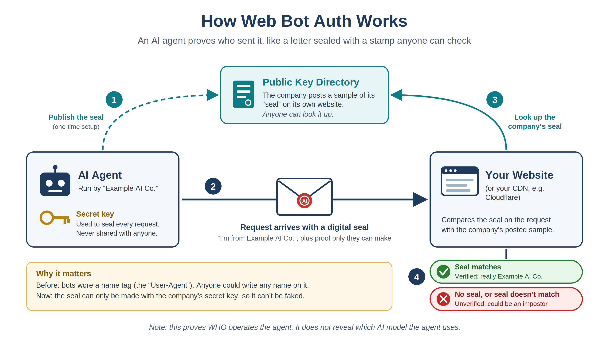

# Identifying AI Agents on Your Website

*Approaches, standards work, and references for site owners*

Prepared October 2026. Specifications and vendor documentation in this area change quickly; check the references for current versions.

> **Bottom line.** A website can often tell **which company or product** is behind an automated visit, but almost never **which AI model** is driving it. No HTTP request carries model identity, and no current standard adds it. The most reliable signal today is cryptographic: Web Bot Auth lets an operator sign its requests so you can verify who sent them. Everything else (names in headers, IP addresses, behavior) is either easy to fake or only a probability.

## Approaches at a glance

| Approach | What it tells you | Can it be faked? | Effort for you |
|---|---|---|---|
| 1. User-Agent strings | Vendor and purpose (training crawl, search, user-requested fetch) | Yes, trivially | Very low (read logs) |
| 2. Published IP ranges | Request really came from the vendor’s network | Hard, but lists change and not every vendor publishes them | Low to medium |
| 3. Web Bot Auth signatures | Cryptographic proof of the operator | No, without the operator’s secret key | Low behind a CDN; medium to verify yourself |
| 4. CDN bot management | Classified bot/agent category, verified bots | Depends on the provider’s methods | Low (configuration) |
| 5. Behavioral fingerprinting | Likely automated vs. human | Partly; it is a probability, not proof | Medium to high |
| 6. Asking the agent | Whatever the agent chooses to say | Yes; unreliable and not recommended | Low, but risky |

None of these approaches reliably identifies the underlying model. A single product (for example, a chat assistant) sends the same identity no matter which model the user selected, and agents built by third parties on a model API show the developer’s own identity, not the model provider’s.

## 1. User-Agent strings

Well-behaved AI crawlers and fetchers identify themselves in the User-Agent header and document what each bot is for. Vendors now separate bots by purpose, which lets you allow search and user-requested fetches while blocking training crawls in `robots.txt`. This is the easiest signal to read and the easiest to fake: any client can send any User-Agent, and bots that drive a real browser usually send an ordinary Chrome string.

| Vendor | Bot names | Purpose | Docs |
|---|---|---|---|
| Anthropic | `ClaudeBot`, `Claude-SearchBot`, `Claude-User` | Training data collection; search indexing; fetching a page because a user asked Claude | [1] |
| OpenAI | `GPTBot`, `OAI-SearchBot`, `ChatGPT-User`, `OAI-AdsBot` | Training; ChatGPT search; user actions in ChatGPT; ad landing-page checks | [2] |
| Perplexity | `PerplexityBot`, `Perplexity-User` | Search indexing; user-requested fetches | [3] |

User-initiated fetchers are treated differently. OpenAI notes that robots.txt rules may not apply to ChatGPT-User, and Perplexity says Perplexity-User generally does not follow robots.txt, because a person asked for that page. See the vendor pages for current details.

## 2. Published IP ranges

Some vendors publish the IP addresses their bots use, so you can confirm that a request claiming to be a given bot really came from that vendor. Match both the User-Agent and the source IP.

- **OpenAI** publishes JSON files per bot, for example `openai.com/gptbot.json`, `openai.com/searchbot.json` and `openai.com/chatgpt-user.json` [2].
- **Perplexity** publishes `perplexity.com/perplexitybot.json` and `perplexity.com/perplexity-user.json` [3].
- **Anthropic’s** crawler article describes how to verify its bots; check the current version for IP information [1].

Limitations: lists change and must be refreshed automatically, cloud IP space can be shared, and IP checks say nothing about traffic that does not claim to be a known bot. Third-party agents run from ordinary cloud or residential addresses.

## 3. Web Bot Auth (HTTP Message Signatures)

Web Bot Auth replaces “trust the name tag” with “check the signature.” It builds on RFC 9421, HTTP Message Signatures [4], a finished IETF standard, and adds a profile for bots and agents. The work began as individual drafts from Cloudflare and is now in the IETF **webbotauth** working group, with authors from Cloudflare and Google [5][6][7].

### How it works

**Keys.** The operator generates a key pair (Cloudflare uses Ed25519) and publishes the public key as a JSON Web Key Set at `/.well-known/http-message-signatures-directory` on its own domain [7][8].

**Signing.** Each request carries `Signature`, `Signature-Input` and `Signature-Agent` headers. The signature covers at least the target host (`@authority`), with `created` and `expires` timestamps, a `keyid` (the key’s thumbprint), and the tag `web-bot-auth`. Short validity windows and nonces limit replay [5][6].

**Verification.** Your server or CDN fetches the operator’s key directory and checks the signature. If it verifies, the request came from that operator, regardless of the IP address or User-Agent it used.

*Figure 1. Web Bot Auth explained for a non-technical audience. (Keep `web-bot-auth-diagram.png` in the same folder as this file for the image to display.)*

### Status and adoption

The protocol draft adopted by the working group (`draft-ietf-webbotauth-httpsig-protocol`) was last updated in September 2026 [5]. Specifications may still change. Cloudflare already uses Web Bot Auth to verify bots and “signed agents” in production, and publishes setup instructions and a blog post on the program [8][9]. If your site is behind Cloudflare, you can write rules against verified-bot fields without implementing signature checks yourself.

> **What it does not do:** it proves the *operator* of the agent, not the model, and it only helps with agents whose operators choose to sign. Unsigned traffic remains unidentified.

## 4. CDN and bot-management services

Content delivery and security providers (Cloudflare, Akamai, Fastly and others) classify traffic as known AI crawlers, verified bots, signed agents, or likely automation, and let you allow, block, rate-limit or challenge it. They combine the signals above with their own network-wide data, which is far more than a single site can see. For most site owners this is the most practical route, and it is how Web Bot Auth is usually consumed today [8].

## 5. Behavioral and browser fingerprinting

Agents that drive a real browser (computer-use agents, AI browser extensions, agentic browsers) look like human visitors at the header level. Timing, navigation patterns, pointer movement, and headless-browser fingerprints can suggest automation. These techniques give a probability rather than proof, produce false positives on real users, and cannot tell you which vendor or model is involved. They are best left to a bot-management provider.

## 6. Asking the agent to identify itself

Some sites hide instructions in pages telling AI agents to report their model, for example by submitting a form or loading a tracking URL. This is not recommended. Models often do not know their exact version, many agents are designed to ignore instructions embedded in web content (this is a form of prompt injection), the answer can be fabricated, and vendors may treat the practice as adversarial. If you want agents to know your policies, publish them openly (robots.txt, terms of use, or emerging declaration formats; see the W3C Introduction Layer group below).

## Standards landscape

### IETF

Bot and agent authentication at the HTTP level is being standardized at the IETF in the **webbotauth** working group, which owns the Web Bot Auth protocol and key-directory drafts [5][6][7][10].

### W3C

There is no W3C Working Group (formal standards track) on this topic. Several W3C **Community Groups** work on agent identity and related questions. Community Groups are open to anyone, are run by their participants, and do not necessarily represent the views of the W3C Membership or staff.

| Group | Launched | Focus |
|---|---|---|
| AI Agent Protocol CG [11] | 2025 | Open protocols for agents to discover, identify and collaborate across the Web, including an agent identity model and a web-based DID method (did:wba). |
| Agent Identity Registry Protocol CG [12] | April 2026 | A DID method for agent identity resolution, an agent credential format based on W3C Verifiable Credentials, and a trust negotiation protocol for cross-organizational agents. |
| Agent Declaration and Assurance CG [13] | June 2026 | Verifiable ways for AI systems to declare their identity, operational boundaries, and alignment constraints. Closest to declaring what an agent is. |
| Introduction Layer CG [14] | August 2026 | The reverse direction: a way for a website to declare its identity, purpose, constraints and responsible party to AI agents in a machine-readable form. |

Related work outside these two bodies includes NIST’s AI agent identity efforts, the OpenID Foundation’s AI identity community group, and the IETF WIMSE working group, all of which the Agent Identity Registry Protocol CG says it expects to coordinate with [12].

## Practical recommendations

For a site that publishes data, a sensible approach today is to:

1. Decide your policy per bot purpose in `robots.txt` (training, search, user-requested fetches).
2. Verify claimed bots against published IP ranges or, better, signatures.
3. Let a CDN’s bot management handle verification, signed agents, and unidentified automation.
4. Treat anything unsigned and unverified as unknown rather than trusting its stated name.
5. Watch the IETF webbotauth drafts and the W3C Community Groups if you want to influence where agent identity goes next.

## References

1. Anthropic. Crawler documentation (ClaudeBot, Claude-SearchBot, Claude-User). <https://support.claude.com/en/articles/8896518>
2. OpenAI. Overview of OpenAI crawlers. <https://developers.openai.com/docs/gptbot>
3. Perplexity. Perplexity Crawlers. <https://docs.perplexity.ai/docs/resources/perplexity-crawlers>
4. IETF. RFC 9421, HTTP Message Signatures. <https://www.rfc-editor.org/rfc/rfc9421>
5. Meunier, T. and Major, S. HTTP Message Signatures for automated traffic (draft-ietf-webbotauth-httpsig-protocol). <https://datatracker.ietf.org/doc/draft-ietf-webbotauth-httpsig-protocol/>
6. Meunier, T. HTTP Message Signatures for automated traffic: Architecture (earlier individual draft). <https://www.ietf.org/archive/id/draft-meunier-web-bot-auth-architecture-00.html>
7. Meunier, T. and Major, S. HTTP Message Signatures Directory. <https://www.ietf.org/archive/id/draft-meunier-webbotauth-httpsig-directory-00.html>
8. Cloudflare. Web Bot Auth (developer documentation). <https://developers.cloudflare.com/bots/concepts/bot/verified-bots/web-bot-auth/>
9. Cloudflare Blog. Message Signatures are now part of our Verified Bots Program. <https://blog.cloudflare.com/verified-bots-with-cryptography/>
10. IETF. Web Bot Auth working group draft repository. <https://github.com/webbotauth/draft-ietf-webbotauth-httpsig-protocol>
11. W3C. AI Agent Protocol Community Group. <https://www.w3.org/community/agentprotocol/>
12. W3C. Agent Identity Registry Protocol Community Group. <https://www.w3.org/community/agent-identity/>
13. W3C. Agent Declaration and Assurance Community Group. <https://www.w3.org/community/adacg/>
14. W3C. Introduction Layer Community Group (call for participation). <https://www.w3.org/community/intro-layer/2026/08/13/call-for-participation-in-introduction-layer-community-group/>
