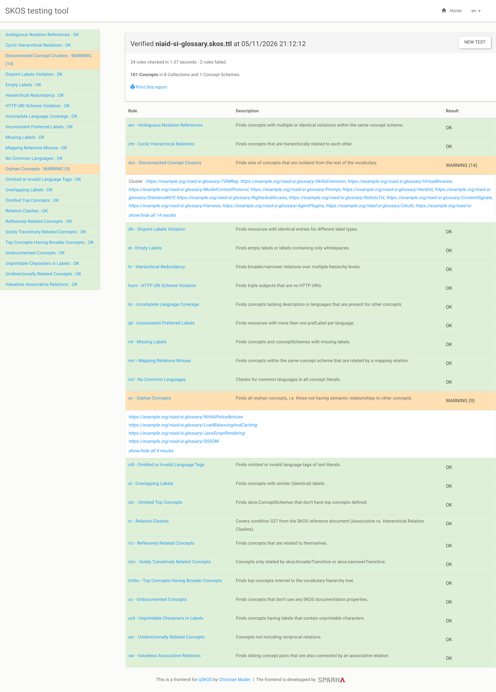

# Glossary To SKOS

## About

This is a record of an experiment.  The glossary was converted to SKOS using the Anthropic Opus 5.5 though the web UI.  the GitHub URL for the glossary was passed with the following simple request.

```aiignore
can you pull the terms at https://github.com/go-fair-us/ai-blueprint-core/blob/master/docs/Webinar_Nov_2026/glossary.md and make a valid SKOS document from them
```

The Turtle SKOS file can be found at https://github.com/go-fair-us/ai-blueprint-core/blob/master/docs/Webinar_Nov_2026/assets/glossary2SKOS/niaid-si-glossary.skos.ttl


## Results

The results were then run through the SPARNA SKOS testing tool at https://skos-play.sparna.fr/skos-testing-tool/.  

The results were not perfect, but they were a good start.  Screenshot of the results are shown below.

